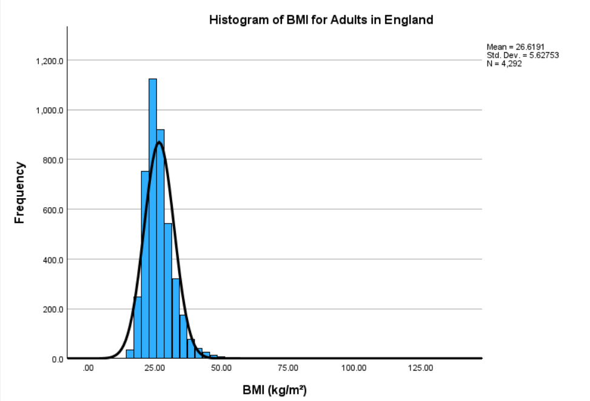
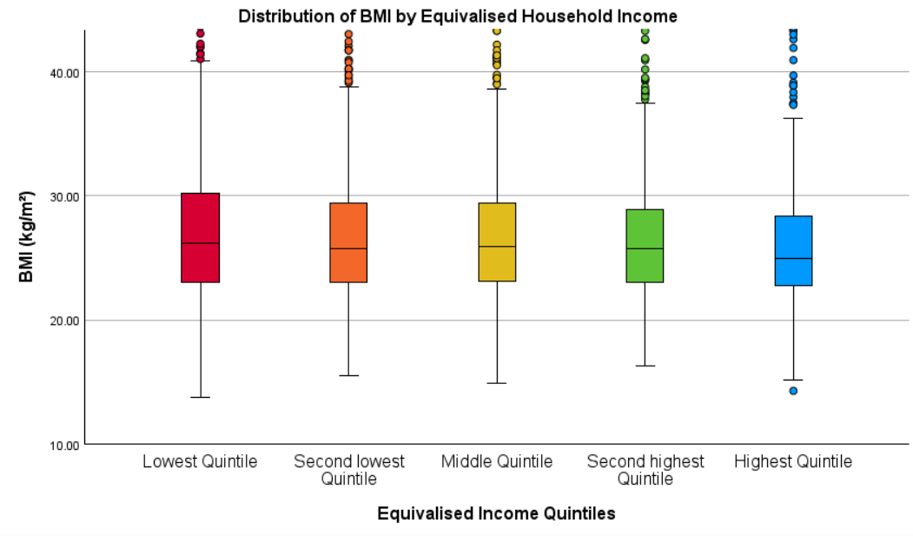

# Analysis of Socioeconomic Inequalities in BMI

## Project Overview

This project investigates socioeconomic inequalities in Body Mass Index (BMI) among adults in England using data from the Health Survey for England (HSE) 2021.

The analysis examines relationships between household income, educational attainment, age, sex and BMI. Using IBM SPSS Statistics, the project combines descriptive statistics, exploratory data analysis, hypothesis testing, non-parametric statistical methods and multiple linear regression.

The study analysed **4,292 adults**, identifying statistically significant differences in BMI across household income and education groups. However, household income was not a statistically significant predictor of BMI after adjusting for age, sex and educational attainment.

The project demonstrates statistical analysis, hypothesis testing, regression modelling and the interpretation of socioeconomic health inequalities.

## Project Structure

```text
socioeconomic-inequalities-bmi-analysis/
│
├── 01_data/
│   └── health_survey_england_2021.sav
│
├── 02_analysis/
│   └── bmi_socioeconomic_analysis.spv
│
├── 03_visualisations/
│   ├── bmi_by_income_quintile.png
│   └── bmi_distribution.png
│
├── 04_reports/
│   └── bmi_socioeconomic_inequalities_report.pdf
│
└── README.md
```

### Directory Overview

| Directory / File | Description |
|------------------|-------------|
| `01_data/` | Health Survey for England 2021 dataset in SPSS format. |
| `02_analysis/` | SPSS output containing descriptive statistics, hypothesis tests and regression results. |
| `03_visualisations/` | Visualisations of BMI distribution and differences across household income groups. |
| `04_reports/` | Detailed report documenting the methodology, statistical findings and interpretation. |
| `README.md` | Project overview, methodology, results and usage instructions. |

## Dataset

- **Source:** Health Survey for England (HSE) 2021
- **Geographical Coverage:** England, United Kingdom
- **Study Design:** Cross-sectional survey
- **Original Sample:** 7,120 individuals
- **Final Analytical Sample:** 4,292 adults
- **Format:** SPSS (`.sav`)

The Health Survey for England contains demographic, socioeconomic and health-related information collected through household interviews and health assessments.

### Variables Used

| Variable | SPSS Variable | Description |
|----------|---------------|-------------|
| Body Mass Index | `bmisr` | Continuous BMI measurement (kg/m²) |
| Household Income | `eqv5` | Equivalised household income divided into five quintiles |
| Sex | `sex` | Male or female |
| Age | `age16g5` | Age categorised into five-year bands |
| Educational Attainment | `topqual4` | Highest educational qualification |

Equivalised household income accounts for differences in household size and composition, allowing comparisons between households with different circumstances.

## Research Objectives

The analysis addresses three objectives:

1. Investigate the distribution of BMI across household income quintiles.
2. Determine whether statistically significant differences in BMI exist between income groups.
3. Examine the relationship between income and BMI after accounting for age, sex and educational attainment.

The study also investigates how socioeconomic and demographic factors relate to BMI variation.

## Methodology

### 1. Data Preparation

Data preprocessing was completed using IBM SPSS Statistics 29.

The original dataset contained 7,120 individuals.

The cleaning process involved:

- Excluding individuals younger than 16 years.
- Identifying missing observations across selected variables.
- Removing implausible BMI values below 10 or above 125 kg/m².
- Applying listwise deletion to observations with missing values.
- Checking categorical variable coding and labels.

The final analytical sample contained **4,292 adults**.

### 2. Descriptive Statistics

Descriptive analysis examined:

- Mean and median BMI.
- Standard deviation and variability.
- BMI distributions across income quintiles.
- Age, sex and educational attainment distributions.

### 3. Statistical Assumption Testing

The following tests assessed statistical assumptions:

- **Kolmogorov-Smirnov Test:** Assessed normality of the BMI distribution.
- **Levene's Test:** Assessed equality of variances across income groups.

Both tests identified violations of relevant statistical assumptions, supporting the use of non-parametric methods for group comparisons.

### 4. Inferential Statistical Analysis

| Statistical Method | Purpose |
|--------------------|---------|
| Kruskal-Wallis H Test | Compare BMI distributions across income and education groups |
| Mann-Whitney U Test | Conduct pairwise income comparisons and assess sex differences |
| Spearman's Rank Correlation | Examine associations between age and BMI |
| Multiple Linear Regression | Assess income, age, sex and education simultaneously |

Statistical significance was assessed using p < 0.05.

## Exploratory Data Analysis

### BMI Distribution Among Adults in England



The histogram illustrates the distribution of BMI among the 4,292 adults included in the analysis.

**Descriptive Statistics**

| Metric | Value |
|--------|------:|
| Sample Size | 4,292 |
| Mean BMI | 26.62 kg/m² |
| Median BMI | 25.70 kg/m² |
| Standard Deviation | 5.63 kg/m² |

The BMI distribution was positively skewed, with most observations concentrated between approximately 20 and 35 kg/m².

The Kolmogorov-Smirnov test indicated a statistically significant deviation from normality (D = 0.083, p < 0.001).

### BMI Across Household Income Quintiles



The boxplot compares BMI distributions across five equivalised household income groups.

**BMI by Income Quintile**

| Income Quintile | Sample Size | Mean BMI | Median BMI |
|-----------------|------------:|---------:|-----------:|
| Lowest | 701 | 27.02 | 26.15 |
| Second Lowest | 994 | 26.71 | 25.71 |
| Middle | 860 | 26.89 | 25.89 |
| Second Highest | 919 | 26.49 | 25.76 |
| Highest | 818 | 26.02 | 24.97 |

Adults in the lowest income quintile had the highest mean BMI (27.02 kg/m²), while those in the highest income quintile had the lowest (26.02 kg/m²).

This suggests a modest inverse association between household income and BMI.

## Statistical Results

### 1. BMI Differences Across Income Groups

A Kruskal-Wallis H test identified statistically significant differences in BMI distributions across income quintiles.

| Statistic | Result |
|-----------|--------|
| Kruskal-Wallis H | 18.106 |
| Degrees of Freedom | 4 |
| p-value | 0.001 |

Post-hoc Mann-Whitney U tests identified significant differences primarily between the highest income quintile and the four lower quintiles.

These findings suggest that household income is associated with BMI in unadjusted comparisons.

### 2. Relationship Between Age and BMI

Spearman's rank correlation assessed the relationship between age and BMI.

| Statistic | Result |
|-----------|--------|
| Spearman's ρ | 0.092 |
| p-value | < 0.001 |

The analysis identified a weak but statistically significant positive association between age and BMI.

### 3. Educational Attainment and BMI

A Kruskal-Wallis test identified statistically significant differences in BMI across educational attainment groups.

| Education Level | Mean BMI Rank |
|-----------------|--------------:|
| Degree or equivalent | 2,001.03 |
| Below Degree | 2,219.86 |
| No Qualifications | 2,277.81 |

Participants with no formal qualifications showed higher BMI ranks than those with degree-level qualifications.

These findings indicate an association between educational attainment and BMI within the analysed sample.

### 4. Multiple Linear Regression

Multiple linear regression assessed the combined associations of household income, age, sex and educational attainment with BMI.

**Model Performance**

| Metric | Result |
|--------|--------|
| R² | 0.008 |
| Adjusted R² | 0.007 |
| F-statistic | 9.099 |
| Model p-value | < 0.001 |

The model was statistically significant but explained only approximately **0.8% of the variation in BMI**.

**Regression Coefficients**

| Predictor | Coefficient (B) | p-value | Statistically Significant |
|-----------|----------------:|--------:|---------------------------|
| Household Income Quintile | -0.128 | 0.059 | No |
| Educational Attainment | 0.324 | 0.023 | Yes |
| Sex | -0.202 | 0.239 | No |
| Age | 0.089 | < 0.001 | Yes |

After adjusting for the other predictors:

- **Household Income:** Did not show a statistically significant independent association with BMI.
- **Education:** Remained statistically significant.
- **Age:** Showed a statistically significant positive association with BMI.
- **Sex:** Was not statistically significant in the adjusted model.

The low R² indicates that the included socioeconomic and demographic variables explain only a small proportion of BMI variation.

## Key Findings

- **Income and BMI:** Lower-income groups showed higher average BMI, with statistically significant differences across income quintiles.
- **Education:** Educational attainment was associated with BMI, with lower qualification levels linked to higher BMI.
- **Age:** A weak positive association was observed between age and BMI.
- **Adjusted Analysis:** Household income was not statistically significant after accounting for age, sex and education.
- **Model Explanatory Power:** The regression model explained less than 1% of BMI variation, suggesting additional factors contribute to differences in BMI.

These findings demonstrate the importance of considering multiple socioeconomic and demographic variables when investigating public health inequalities.

## Tools and Technologies

| Tool / Method | Purpose |
|---------------|---------|
| IBM SPSS Statistics 29 | Data cleaning, statistical analysis and visualisation |
| Descriptive Statistics | Summarising BMI distributions and participant characteristics |
| Kolmogorov-Smirnov Test | Assessing normality |
| Levene's Test | Assessing variance homogeneity |
| Kruskal-Wallis H Test | Comparing BMI across multiple groups |
| Mann-Whitney U Test | Comparing BMI between groups |
| Spearman's Correlation | Assessing monotonic associations |
| Multiple Linear Regression | Examining adjusted relationships between variables |

## Installation and Usage

### 1. Clone the Repository

```bash
git clone https://github.com/uche1207/socioeconomic-inequalities-bmi-analysis.git
cd socioeconomic-inequalities-bmi-analysis
```

### 2. Open the Dataset

Open IBM SPSS Statistics and load:

```text
01_data/health_survey_england_2021.sav
```

### 3. Review the Statistical Analysis

Open the SPSS output file:

```text
02_analysis/bmi_socioeconomic_analysis.spv
```

This contains the saved statistical output, including descriptive statistics, assumption testing, hypothesis tests and regression results.

The `.spv` file stores analytical output rather than executable SPSS syntax. Reproducing the analysis requires applying the procedures described in the report.

### 4. View the Visualisations

The `03_visualisations/` directory contains:

- `bmi_distribution.png`: Distribution of BMI among adults.
- `bmi_by_income_quintile.png`: BMI comparisons across household income groups.

## Limitations

- **Cross-Sectional Data:** The analysis identifies associations but does not establish causal relationships.
- **Low Explanatory Power:** The multiple linear regression model explains only 0.8% of BMI variation.
- **Statistical Assumptions:** BMI was positively skewed and variances differed across income groups, requiring caution when interpreting regression results.
- **Missing Data:** Listwise deletion reduced the analytical sample and could introduce selection bias.
- **Unmeasured Variables:** Dietary habits, physical activity, smoking and other lifestyle factors were not included in the regression model.
- **Survey Design:** The analysis does not establish whether survey weighting and complex sampling design were accounted for in the reported estimates.

Future work could incorporate additional lifestyle variables, survey-weighted statistical methods and alternative modelling approaches.

## Report

The full report, including the literature review, methodology, detailed statistical results and discussion, is available below:

[BMI and Socioeconomic Inequalities in England: Statistical Analysis Report](04_reports/bmi_socioeconomic_inequalities_report.pdf)

## Author

**Uche Dumzo-Ajufo**

MSc Data Science | BEng Biomedical Engineering (Hons)

[GitHub](https://github.com/uche1207)